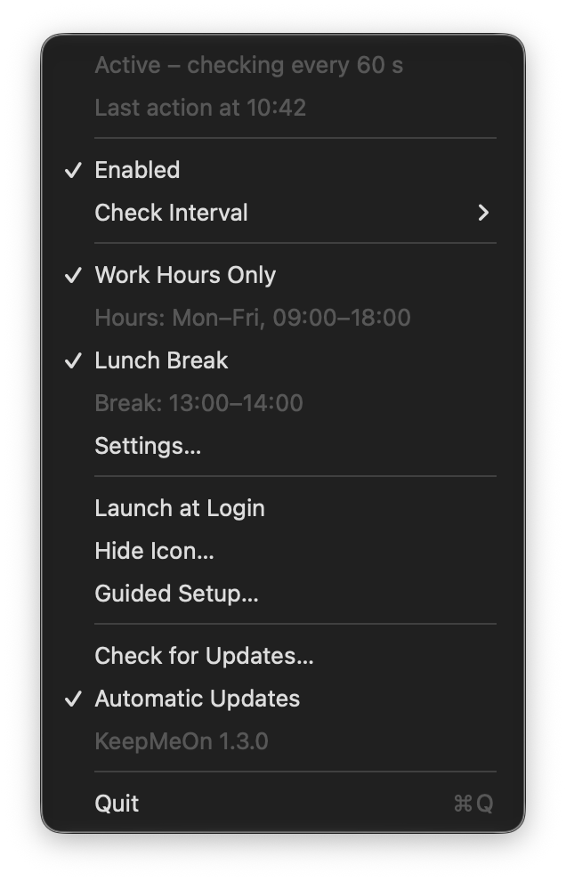

<p align="center">
  
</p>

<h1 align="center">KeepMeOn</h1>

<p align="center">
  Stay available on Microsoft Teams even when you step away for a moment.
</p>

<p align="center">
  <a href="https://github.com/christianmusumeci00/KeepMeOn/releases/latest/download/KeepMeOn.dmg"><b>Download for Mac</b></a>
  ·
  <a href="https://github.com/christianmusumeci00/KeepMeOn/releases/latest/download/KeepMeOn-Setup.exe"><b>Download for Windows</b></a>
  ·
  <a href="#installation">Installation</a>
  ·
  <a href="#building-from-source">Building from source</a>
</p>

<p align="center">
  
  
  
</p>

---

You get up for a coffee, answer the door or grab a printout. After about 5 minutes without mouse or keyboard, Teams marks you as **"Away"**, even though you're about to come back. KeepMeOn keeps your computer "present" during these short breaks, so you stay **green** and your colleagues know they can reach you.

It's a small native app with no external dependencies:

- **Mac:** lives in the menu bar. It's written in Swift and SwiftUI, takes up less than 1 MB and uses about 17 MB of memory at rest.
- **Windows:** lives in the notification area, next to the clock. It's written in C# with Windows Forms on .NET Framework 4.8, which already ships with Windows 10 and 11, so there's nothing extra to install. The installer is about 2 MB.

The app is available in **English** (default) and **Italian**.

<table>
  <tr>
    <th>Mac</th>
    <th>Windows</th>
  </tr>
  <tr>
    <td></td>
    <td></td>
  </tr>
</table>

## What it does

- **It only steps in when you're not using the computer.** Every 60 seconds it checks how long you haven't touched the mouse, keyboard or trackpad, and acts only past 2 minutes. While you work, it does nothing.
- **Hands off.** It doesn't move the mouse, press keys, click or open anything: it only sends a neutral signal to the system (see [How it works](#how-it-works)).
- **Stops on its own** in four cases:
  - when the screen is locked;
  - when the computer is asleep or the display is off;
  - outside work hours, if you set them;
  - during the lunch break, if you turn it on.
- **Work hours:** start and end time and days of the week (default Mon–Fri, 09:00–18:00). Ranges that cross midnight work too.
- **Lunch break:** a daily range in which the app doesn't step in (default 13:00–14:00).
- **Guided setup** on first launch: in a few steps you choose the language, when it should run, the lunch break, startup and updates.
- **English or Italian:** choose the language in the Windows installer, in the guided setup or in the settings. It changes immediately, no restart needed.
- **One-click updates:** from the icon menu, or automatically once a day (can be turned off).
- **Start at login** and the option to **hide the icon**: KeepMeOn can work with nothing visible.
- **No data collection.** Settings stay on your computer. It only connects to the Internet to check GitHub for a new version, and only if automatic updates are on or you ask it to.

If you're stepping away for longer, lock your computer (**⌃⌘Q** on Mac, **Windows+L** on Windows): KeepMeOn pauses and Teams correctly shows that you're away.

## Installation

### Mac (macOS 13 Ventura or later)

1. Download **[KeepMeOn.dmg](https://github.com/christianmusumeci00/KeepMeOn/releases/latest/download/KeepMeOn.dmg)**.
2. Open the DMG and drag **KeepMeOn** into the **Applications** folder.
3. Open **KeepMeOn** from Applications or Spotlight. The app is signed with a Developer ID certificate and notarized by Apple, so it opens with a double-click. Since it comes from the Internet, macOS asks for a single confirmation: click **Open**.
4. The **guided setup** opens. On the first screen, choose the **language** at the bottom left, then go through the steps with **Next**:
   1. **Accessibility permission:** click **Open Accessibility Settings** and turn on **KeepMeOn** in the list. The app relaunches on its own, because macOS only applies this permission at launch, and the setup picks up where you left off.
   2. **When it should run:** always, or only during work hours, with times and days.
   3. **Lunch break:** whether KeepMeOn should stop, and during which range.
   4. **Startup and updates:** launch at login and automatic update checks.
5. On the summary, click **Get Started**.

A coffee cup appears in the menu bar.

**With Homebrew.** Instead of steps 1 and 2, you can run:

```bash
brew install --cask christianmusumeci00/tap/keepmeon
```

Then continue from step 3. Updates still come from the app itself, as described in [Updates](#updates).

### Windows (Windows 10 and 11)

1. Download **[KeepMeOn-Setup.exe](https://github.com/christianmusumeci00/KeepMeOn/releases/latest/download/KeepMeOn-Setup.exe)** and run it.
2. The installer isn't signed with a paid certificate, so the first time Windows shows "Windows protected your PC". Click **More info** › **Run anyway**.
3. Choose the **language** (English or Italiano): the installer and the app will use it.
4. The installation is for your user only: no administrator rights needed. If you like, leave the "Start KeepMeOn when you sign in to Windows" option on.
5. The **guided setup** opens: choose when it should run, the lunch break, startup at sign-in and updates, then click **Get Started**. On Windows there's no permission to grant.

The cup appears in the notification area, next to the clock. If you don't see it, open the "Show hidden icons" arrow and drag it onto the taskbar.

## Usage

### The icon

<table>
  <tr>
    <th>Mac, menu bar</th>
    <th>Windows, notification area</th>
  </tr>
  <tr>
    <td></td>
    <td></td>
  </tr>
</table>

| Icon | Meaning |
|---|---|
| Empty cup (Mac) or gray cup (Windows) | KeepMeOn is off |
| Cup without a checkmark | On but paused: lunch, outside work hours, screen locked (on Mac also missing permission) |
| Cup with a checkmark | Keeping you green |

### The menu

On Mac it opens from the cup in the menu bar; on Windows with a click, left or right, on the cup next to the clock.

<table>
  <tr>
    <th>Mac</th>
    <th>Windows</th>
  </tr>
  <tr>
    <td></td>
    <td></td>
  </tr>
</table>

| Item | What it does |
|---|---|
| Status | For example "Active – checking every 60 s", "Paused – lunch break", "Paused – screen locked" |
| Last action at… | The last time KeepMeOn stepped in |
| Grant Accessibility Permission… | Mac only, and only if the permission is missing |
| Enabled | Turns the app on or off |
| Check Interval | 30, 60, 120 or 240 seconds (default 60) |
| Work Hours Only | Limits the app to the time range |
| Lunch Break | Stops the app during the break, every day |
| Settings… | Opens the window with language, work hours and lunch break |
| Launch at Login (Mac) / Start with Windows (Windows) | Starts KeepMeOn when you sign in to the computer |
| Hide Icon… | Removes the icon. To get it back, open KeepMeOn again: on Mac from Spotlight or Applications, on Windows from the Start menu |
| Guided Setup… | Reopens the guided setup from the beginning |
| Check for Updates… | Looks for a new version on GitHub right away |
| Automatic Updates | Checks on its own once a day (on by default) |
| KeepMeOn 1.3.0 | The installed version |
| Quit (Mac) / Exit (Windows) | Closes the app |

### Updates

When a new version is available, KeepMeOn asks whether to install it: **Install and Relaunch** downloads it, installs it and reopens the app on its own. Settings, language and permissions are kept; **What's New…** (on Windows "Read what's new") shows what changed.

- **Mac:** before installing, KeepMeOn checks that the new app is signed by the same developer as the one in use; if it isn't, the update is rejected. KeepMeOn must be able to write to the folder it's in, for example Applications.
- **Windows:** the new version's installer runs without windows and keeps your choices for startup at sign-in and language.

The automatic check is a simple request to the public GitHub releases address: it doesn't send any personal data.

### Settings

<table>
  <tr>
    <th>Mac</th>
    <th>Windows</th>
  </tr>
  <tr>
    <td></td>
    <td></td>
  </tr>
</table>

- **Language:** English or Italiano. Menu and open windows switch right away.
- In work hours the start is included and the end excluded: 09:00–18:00 lasts until 17:59.
- If the end comes before the start (for example 22:00–06:00), the range crosses midnight and counts for the day it started. If start and end are the same, it covers the whole day.
- The lunch break applies every day; if start and end are the same, it's empty.

The language can also be set from the command line, then restart the app.

On Mac:

```bash
defaults write com.keepmeon.app language it   # or en
```

On Windows:

```bat
reg add HKCU\Software\KeepMeOn /v Language /t REG_SZ /d it /f
```

## How it works

Teams goes "Away" after about 5 minutes in which the system's idle timer isn't reset. At each check, if you haven't used the computer for at least 120 seconds, KeepMeOn does two things: it asks the system to stay awake and it resets that timer with a neutral signal.

Both are needed, on Mac as on Windows. The system's "stay awake" function alone doesn't reset the timer that Teams reads: this was verified on both systems.

### Mac

1. **Declares activity to macOS** with `IOPMAssertionDeclareUserActivity`: the system postpones display sleep, the screen saver and Mac sleep.
2. **Resets the timer that Teams reads** (`CGEventSourceSecondsSinceLastEventType(combinedSessionState, …)`) with an "unchanged modifiers" `flagsChanged` event. To apps, it's as if you released a ⌘ ⌥ ⇧ ⌃ key you weren't pressing: no cursor, no character, no click.
   - The event carries the same modifiers that are already active (at most Caps Lock) and isn't sent if a modifier is held down.
   - It's tagged with the `KMON` identifier, so it can be recognized.
   - Posting events on macOS requires the Accessibility permission.

### Windows

1. **Asks Windows to stay awake** with `SetThreadExecutionState`: it postpones sleep and display power-off.
2. **Resets the idle timer** (`GetLastInputInfo`) with `SendInput`, reporting the release of a key that doesn't exist: virtual key code 0x97, which Windows doesn't assign to anything. No app reacts to it and the cursor doesn't move. This signal is also tagged `KMON`.
   - On Windows no permission is needed.

On a Windows 11 computer the signal brought the timer from 144 s to 0.3 s without moving the cursor, while `SetThreadExecutionState` alone didn't reset it.

### Timing and threshold

With the default values the timer doesn't go beyond about 3 minutes: in a 7.5-minute measurement without input on Mac it peaked at 181 s, below Teams' 300 s. With the 240 s interval, the threshold drops on its own to 21 s, so it never reaches 5 minutes.

The 120 s threshold can be changed; then restart the app.

On Mac:

```bash
defaults write com.keepmeon.app idleThresholdSeconds -int 90
```

On Windows:

```bat
reg add HKCU\Software\KeepMeOn /v IdleThresholdSeconds /t REG_DWORD /d 90 /f
```

## Building from source

```bash
git clone https://github.com/christianmusumeci00/KeepMeOn.git
cd KeepMeOn
```

### Mac

**Requirements:**
- macOS 13 Ventura or later.
- Xcode 15 or later, or the Command Line Tools with Swift 5.9 or later. Tests (`swift test`) and the universal build may require full Xcode.

| Command | Result |
|---|---|
| `./build.sh` | `dist/KeepMeOn.app` for your Mac's architecture |
| `UNIVERSAL=1 ./build.sh` | universal `dist/KeepMeOn.app` (Apple Silicon and Intel) |
| `./make-dmg.sh` | universal `dist/KeepMeOn.dmg`, with the Applications shortcut (notarized if a certificate and credentials are available, see below) |
| `swift test` | tests for the logic (hours, lunch break, state, threshold, languages) |

Then launch the app:

```bash
open dist/KeepMeOn.app
```

**Signing.** `build.sh` picks the certificate from the keychain on its own, in this order:
1. "Developer ID Application": for distribution. Signs with the hardened runtime and a timestamp, as notarization requires.
2. "Apple Development": for use on your own Mac.
3. If it finds neither, it signs ad hoc.

With a certificate, macOS recognizes the app by who signed it, so the Accessibility permission stays valid after a new build. With ad hoc signing, the permission has to be granted again after every build.

To choose the signature manually:

```bash
SIGN_IDENTITY=- ./build.sh                     # force ad hoc signing
SIGN_IDENTITY="Certificate name" ./build.sh
```

**Notarization.** With a Developer ID certificate, `make-dmg.sh` has Apple notarize first the app and then the DMG. It then staples the notarization ticket to both and checks that macOS accepts them. Save the credentials first, just once: you'll be asked for an [app-specific password](https://support.apple.com/102654) for your Apple Account.

```bash
xcrun notarytool store-credentials "KeepMeOn" --apple-id "your-apple-id" --team-id "YOUR_TEAM_ID"
```

Without credentials the DMG is still created and signed, but not notarized.

### Windows

**Requirements:**
- For the app and the tests, the [.NET SDK 10](https://dotnet.microsoft.com/download) is enough, on Windows, Mac or Linux: the app targets .NET Framework 4.8 and builds anywhere.
- The installer needs Windows and [Inno Setup 6](https://jrsoftware.org/isinfo.php).

| Command | Result |
|---|---|
| `dotnet test windows/tests/KeepMeOn.Core.Tests` | tests for the logic (hours, lunch break, state, threshold, languages) |
| `dotnet build windows/src/KeepMeOn -c Release` | `windows/src/KeepMeOn/bin/Release/net48/KeepMeOn.exe` |
| `ISCC.exe windows\installer\KeepMeOn.iss` (on Windows, after the build) | `windows/dist/KeepMeOn-Setup.exe` |

**On GitHub.** On every change to the `windows/` folder, the [`.github/workflows/windows.yml`](.github/workflows/windows.yml) workflow does everything on a Windows machine:
- runs the tests;
- builds the app;
- checks that the neutral signal really resets the idle timer;
- takes pictures of the windows;
- creates the installer;
- checks the silent installation used by updates, including the language it saves.

The result can be downloaded from the build page, under the name "KeepMeOn-Windows".

### Icons

They're drawn in code. The script creates the Mac icon and the `.ico` icons for Windows; run it on a Mac:

```bash
swift Support/icon/make-icon.swift
```

### Languages

The texts are in the code, with the English and Italian versions side by side: `tr("Settings", "Impostazioni")` on Mac, `L10n.T("Settings", "Impostazioni")` on Windows. The language is saved in `UserDefaults` (Mac) or in the registry (Windows) under the `language` / `Language` key, with the value `en` or `it`. Anyone who already used version 1.2 or earlier, which was Italian only, keeps Italian after updating.

## FAQ

**Teams turned yellow anyway.**
Open the menu and look at the status:
- **"permission missing"** (Mac only): the Accessibility permission isn't on for this copy of the app (see below);
- **"Paused":** at that moment KeepMeOn is right not to step in;
- **"Off":** turn **Enabled** back on.

**Mac: the menu says "permission missing" even though the switch is on in the Accessibility list.**
The entry in the list belongs to another build of KeepMeOn, for example one built with a different signature, and turning the switch back on isn't enough. To fix it:
1. Delete the entry:

   ```bash
   tccutil reset All com.keepmeon.app
   ```

2. Quit KeepMeOn and open it again.
3. Grant the permission again from the menu (**Grant Accessibility Permission…**).

**Windows: when the installer starts, "Windows protected your PC" appears.**
This happens because the installer isn't signed with a paid certificate. Click **More info** › **Run anyway**. It's only needed the first time.

**How do I change the language?**
From the menu, choose **Settings…** and pick the language at the top. You can also choose it on the first screen of the guided setup (**Guided Setup…**) and, on Windows, at the start of the installer.

**I can't see the icon.**
- **Mac:** it may be hidden by a menu bar manager (Bartender, Ice, Thaw…) or by the screen notch.
- **Windows:** open the "Show hidden icons" arrow next to the clock and drag the cup onto the taskbar.
- If you hid it yourself with **Hide Icon…**, open KeepMeOn again (Spotlight on Mac, Start menu on Windows).

**How do I check that it works?**
- In the menu, "Last action at…" shows the time of the last action.
- On Mac, to see every action in real time:

  ```bash
  log stream --predicate 'subsystem == "com.keepmeon.app"' --level debug
  ```

- On Windows every action is written to `%LOCALAPPDATA%\KeepMeOn\keepmeon.log`.

**How do I update KeepMeOn?**
From the icon menu choose **Check for Updates…**; if there's a new version, click **Install and Relaunch**. With **Automatic Updates** on, KeepMeOn checks on its own once a day and lets you know. If the update fails, you can always download the latest version from the [Releases](https://github.com/christianmusumeci00/KeepMeOn/releases/latest) page.

**The computer no longer locks on its own.**
That's intended: while KeepMeOn is on and not paused, the computer doesn't sleep due to inactivity. When you step away for a long time, lock it (⌃⌘Q on Mac, Windows+L on Windows).

## Known limitations

- With the screen locked or the computer asleep, Teams goes "Away" anyway. That's intended.
- A status set manually in Teams, meetings and the calendar are still handled by Teams.
- If Microsoft changes how Teams measures inactivity, the behavior may change.
- On Windows, if a program started as administrator is in the foreground, Windows may block the neutral signal (UIPI protection) and Teams may go "Away".
- If your computer is managed by your company, check that this use is allowed; IT rules may also prevent installing programs. For an IT check the app stays visible: running process, start at login and, on Mac, the Accessibility list.

## Uninstalling

### Mac

1. From the menu turn off **Launch at Login**, then choose **Quit**. If the icon is hidden, open KeepMeOn again first to bring it back.
2. Move `KeepMeOn.app` to the Trash. If you installed it with Homebrew, run `brew uninstall --cask keepmeon` instead.
3. In System Settings › Privacy & Security › Accessibility, remove KeepMeOn.
4. Optional, to delete the settings:

   ```bash
   defaults delete com.keepmeon.app
   ```

### Windows

1. Go to Settings › Apps › Installed apps.
2. Find **KeepMeOn** › **Uninstall**.

Uninstalling closes the app and also removes the startup entry and the settings.

## Project structure

```
KeepMeOn/
├── build.sh, make-dmg.sh       Mac: build, signing, DMG and notarization
├── Package.swift
├── Support/
│   ├── Info.plist              bundle id, LSUIElement, version, icon
│   ├── AppIcon.icns
│   └── icon/make-icon.swift    draws the icons for Mac and Windows
├── Sources/
│   ├── KeepMeOnCore/           Mac: pure logic (hours, lunch break, state, languages), covered by tests
│   └── KeepMeOn/               Mac: menu bar app (SwiftUI)
├── Tests/KeepMeOnCoreTests/
├── windows/
│   ├── src/KeepMeOn.Core/      Windows: the same pure logic in C#
│   ├── src/KeepMeOn/           Windows: notification area app (Windows Forms)
│   ├── tests/                  tests for the logic (xUnit)
│   ├── tools/KeepMeOn.Probe/   checks on Windows: neutral signal, pictures and installer
│   └── installer/KeepMeOn.iss  installer (Inno Setup), in English and Italian
├── .github/workflows/windows.yml   build and checks on Windows
└── docs/                       README images
```

## License

[MIT](LICENSE) © 2026 Christian Musumeci

Microsoft Teams is a trademark of Microsoft Corporation. KeepMeOn is an independent project, not affiliated with or endorsed by Microsoft.
