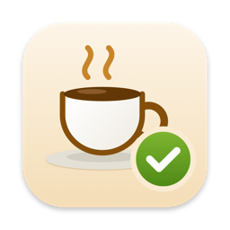
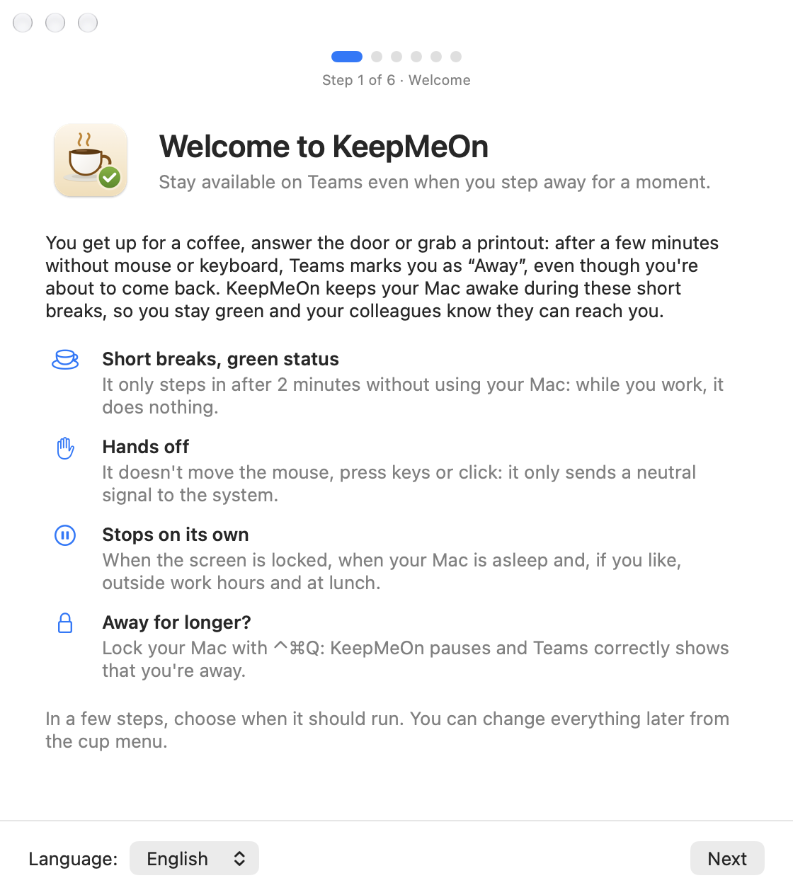
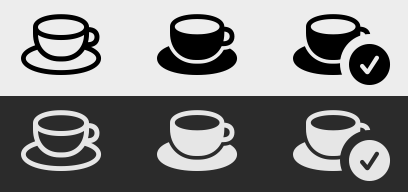
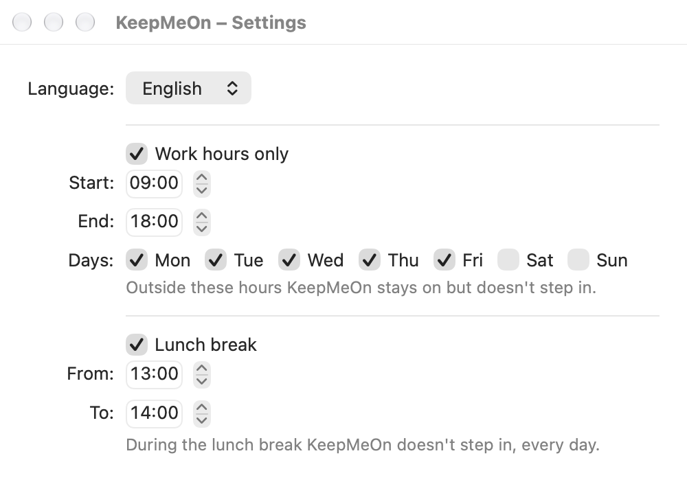

<p align="center">
  
</p>

<h1 align="center">KeepMeOn</h1>

<p align="center">
  Resta disponibile su Microsoft Teams anche quando ti allontani per un attimo.
</p>

<p align="center">
  <a href="https://github.com/christianmusumeci00/KeepMeOn/releases/latest/download/KeepMeOn.dmg"><b>Scarica KeepMeOn.dmg</b></a>
  ·
  <a href="#installazione">Installazione</a>
  ·
  <a href="#compilare-da-zero">Compilare da zero</a>
</p>

<p align="center">
  
  
  
</p>

---

Ti alzi per un caffè, rispondi al citofono o vai a ritirare una stampa. Dopo circa 5 minuti senza mouse e tastiera, Teams ti segna **«Assente»**, anche se stai per tornare. KeepMeOn tiene il Mac "presente" durante queste brevi pause, così resti **verde** e i colleghi sanno che sei raggiungibile.

È una piccola app per la barra dei menu, nativa per macOS (Swift e SwiftUI), senza dipendenze esterne:
- l'app installata occupa meno di 1 MB;
- a riposo usa circa 17 MB di memoria;
- il consumo di CPU è trascurabile.

<p align="center">
  
</p>

## Cosa fa

- **Interviene solo quando non usi il Mac.** Ogni 60 secondi controlla da quanto tempo non tocchi mouse, tastiera o trackpad, e agisce solo oltre i 2 minuti. Mentre lavori non fa nulla.
- **Non tocca niente.** Non muove il mouse, non preme tasti, non clicca e non apre niente: invia soltanto un segnale neutro al sistema (vedi [Come funziona](#come-funziona)).
- **Si ferma da sola** in quattro casi:
  - con lo schermo bloccato;
  - con il Mac o gli schermi in stop;
  - fuori dall'orario di lavoro, se lo imposti;
  - durante la pausa pranzo, se la attivi.
- **Orario di lavoro:** ora di inizio e di fine e giorni della settimana (predefinito lun–ven, 09:00–18:00). Funzionano anche le fasce a cavallo della mezzanotte.
- **Pausa pranzo:** una fascia giornaliera in cui l'app non interviene (predefinita 13:00–14:00).
- **Avvio al login** e possibilità di **nascondere l'icona**: KeepMeOn può lavorare senza nulla di visibile.
- **Non si collega a Internet e non raccoglie dati.** Le impostazioni restano sul tuo Mac.

Se ti allontani a lungo, blocca il Mac con **⌃⌘Q**: KeepMeOn si mette in pausa e Teams mostra correttamente che sei assente.

## Installazione

1. Scarica **[KeepMeOn.dmg](https://github.com/christianmusumeci00/KeepMeOn/releases/latest/download/KeepMeOn.dmg)** dalla pagina [Release](https://github.com/christianmusumeci00/KeepMeOn/releases).
2. Apri il DMG e trascina **KeepMeOn** nella cartella **Applicazioni**.
3. Apri **KeepMeOn** da Applicazioni o da Spotlight. L'app è firmata con un certificato Developer ID e notarizzata da Apple, quindi si apre con un doppio clic. Visto che arriva da Internet, macOS chiede una sola conferma: premi **Apri**.
4. **Permesso di Accessibilità.**
   1. Nella schermata di benvenuto premi **Apri Impostazioni Accessibilità** e attiva **KeepMeOn** nell'elenco.
   2. L'app si riavvia da sola: macOS applica questo permesso solo all'avvio.
   3. Il benvenuto ricompare con «Permesso attivo».
5. Premi **Inizia**. Se vuoi, attiva **Avvia KeepMeOn al login** direttamente dal benvenuto.

Nella barra dei menu compare una tazzina.

## Uso

### L'icona nella barra dei menu

<p align="center">
  
</p>

| Icona | Significato |
|---|---|
| Tazzina vuota | KeepMeOn è spenta |
| Tazzina piena | Accesa ma in pausa: pranzo, fuori orario, schermo bloccato o permesso mancante |
| Tazzina con spunta | Ti sta tenendo verde |

### Il menu

| Voce | Cosa fa |
|---|---|
| Stato | Per esempio "Attivo – controllo ogni 60 s", "In pausa – pausa pranzo", "In pausa – schermo bloccato" |
| Ultimo intervento | Ora dell'ultima volta in cui KeepMeOn è intervenuta |
| Concedi il permesso di Accessibilità… | Compare solo se il permesso manca |
| Attivo | Accende o spegne l'app |
| Intervallo di controllo | 30, 60, 120 o 240 secondi (predefinito 60) |
| Solo in orario di lavoro | Limita l'azione alla fascia oraria |
| Pausa pranzo | Ferma l'app nella fascia della pausa, tutti i giorni |
| Imposta orari… | Apre la finestra con orario di lavoro e pausa pranzo |
| Avvia al login | Avvia KeepMeOn all'accesso al Mac |
| Nascondi icona… | Toglie l'icona dalla barra; per riaverla riapri KeepMeOn da Spotlight o da Applicazioni |
| Come funziona… | Riapre la schermata di benvenuto, con lo stato del permesso |
| Esci | Chiude l'app (⌘Q) |

### Orari

<p align="center">
  
</p>

- Nell'orario di lavoro l'inizio è incluso e la fine esclusa: 09:00–18:00 vale fino alle 17:59.
- Se la fine viene prima dell'inizio (per esempio 22:00–06:00), la fascia scavalca la mezzanotte e conta per il giorno in cui è iniziata. Se inizio e fine coincidono, copre l'intera giornata.
- La pausa pranzo vale tutti i giorni; se inizio e fine coincidono è vuota.

## Come funziona

Teams calcola l'inattività leggendo il contatore di macOS `CGEventSourceSecondsSinceLastEventType(combinedSessionState, …)`: dopo circa 5 minuti segna «Assente». A ogni controllo, se non usi il Mac da almeno 120 secondi, KeepMeOn fa due cose:

1. **Dichiara attività a macOS** con `IOPMAssertionDeclareUserActivity`: il sistema rimanda stop dello schermo, salvaschermo e stop del Mac.
2. **Azzera il contatore che legge Teams** con un evento `flagsChanged` "modificatori invariati". Per le app è come se lasciassi andare un tasto ⌘ ⌥ ⇧ ⌃ che non stavi premendo: nessun cursore, nessun carattere, nessun clic.
   - L'evento porta gli stessi modificatori già attivi (al massimo Blocco maiuscole) e non parte se un modificatore risulta premuto.
   - È marcato con l'identificativo `KMON`, quindi si riconosce.

Servono entrambi. La sola dichiarazione IOKit tiene sveglio il Mac ma non azzera quel contatore: è stato verificato su macOS 27, dove Teams andava comunque in «Assente». Inviare eventi richiede il permesso di Accessibilità.

Con i valori predefiniti il contatore non supera i 3 minuti circa: in una prova di 7 minuti e mezzo senza input è arrivato al massimo a 181 s, sotto i 300 s di Teams. Con l'intervallo di 240 s la soglia scende da sola a 21 s, così non si arriva mai ai 5 minuti.

La soglia di 120 s si può cambiare da Terminale (poi riavvia l'app):

```bash
defaults write com.keepmeon.app idleThresholdSeconds -int 90
```

## Compilare da zero

**Requisiti:**
- macOS 13 Ventura o successivo.
- Xcode 15 o successivo, oppure i Command Line Tools con Swift 5.9 o successivo. I test (`swift test`) e la build universale potrebbero richiedere Xcode completo.

```bash
git clone https://github.com/christianmusumeci00/KeepMeOn.git
cd KeepMeOn
```

| Comando | Risultato |
|---|---|
| `./build.sh` | `dist/KeepMeOn.app` per l'architettura del tuo Mac |
| `UNIVERSAL=1 ./build.sh` | `dist/KeepMeOn.app` universale (Apple Silicon e Intel) |
| `./make-dmg.sh` | `dist/KeepMeOn.dmg` universale, con il collegamento ad Applicazioni (notarizzato se ci sono certificato e credenziali, vedi sotto) |
| `swift test` | test della logica (orari, pausa pranzo, stato, soglia) |

Poi avvia l'app:

```bash
open dist/KeepMeOn.app
```

**Firma.** `build.sh` sceglie da solo il certificato nel portachiavi, in quest'ordine:
1. "Developer ID Application": per distribuire. Firma con runtime protetto e marca temporale, come richiede la notarizzazione.
2. "Apple Development": per l'uso sul proprio Mac.
3. Se non trova nessuno dei due, firma ad-hoc.

Con un certificato macOS riconosce l'app da chi l'ha firmata, quindi il permesso di Accessibilità resta valido anche dopo una nuova build. Con la firma ad-hoc il permesso va ridato dopo ogni build.

Per scegliere la firma a mano:

  ```bash
  SIGN_IDENTITY=- ./build.sh                     # forza la firma ad-hoc
  SIGN_IDENTITY="Nome del certificato" ./build.sh
  ```

**Notarizzazione.** Con un certificato Developer ID, `make-dmg.sh` fa notarizzare da Apple prima l'app e poi il DMG. Poi allega a entrambi il ticket di notarizzazione e controlla che macOS li accetti. Prima salva le credenziali, una volta sola: ti verrà chiesta una [password per le app](https://support.apple.com/it-it/102654) del tuo ID Apple.

```bash
xcrun notarytool store-credentials "KeepMeOn" --apple-id "il-tuo-id-apple" --team-id "IL_TUO_TEAM_ID"
```

Senza credenziali il DMG viene comunque creato e firmato, ma non notarizzato.

**Icona.** È disegnata in codice. Per rigenerarla:

```bash
swift Support/icon/make-icon.swift Support/AppIcon.icns
```

## Domande frequenti

**Teams è diventato giallo lo stesso.**
Apri il menu e guarda lo stato:
- **"manca il permesso":** il permesso di Accessibilità non è attivo per questa copia dell'app (vedi sotto);
- **"In pausa":** in quel momento è giusto che KeepMeOn non intervenga;
- **"Disattivato":** riattiva **Attivo**.

**Il menu dice "manca il permesso" anche se nell'elenco Accessibilità l'interruttore è attivo.**
La voce nell'elenco appartiene a un'altra build di KeepMeOn, per esempio una compilata con un'altra firma, e riattivare l'interruttore non basta. Per sistemarla:
1. Cancella la voce:

   ```bash
   tccutil reset All com.keepmeon.app
   ```

2. Esci da KeepMeOn e riaprila.
3. Concedi di nuovo il permesso dal benvenuto o dal menu.

**Non vedo l'icona nella barra dei menu.**
Può essere nascosta da un gestore della barra (Bartender, Ice, Thaw…) o dalla tacca dello schermo. Se l'hai nascosta tu con **Nascondi icona…**, riapri KeepMeOn da Spotlight.

**Come verifico che funzioni?**
- Nel menu, "Ultimo intervento" mostra l'ora dell'ultima azione.
- Per vedere ogni intervento in tempo reale:

  ```bash
  log stream --predicate 'subsystem == "com.keepmeon.app"' --level debug
  ```

**Il Mac non si blocca più da solo.**
È voluto: mentre KeepMeOn è attiva e non sei in pausa, il Mac non va in stop per inattività. Quando ti allontani a lungo, bloccalo con ⌃⌘Q.

## Limiti noti

- Con lo schermo bloccato o il Mac in stop Teams va comunque in «Assente». È voluto.
- Lo stato impostato a mano in Teams, le riunioni e il calendario restano gestiti da Teams.
- Se Microsoft cambia il modo in cui Teams misura l'inattività, il comportamento potrebbe cambiare.
- Se il Mac è gestito dall'azienda, verifica che l'uso sia consentito. Per un controllo IT l'app resta visibile: processo attivo, elenco Accessibilità, elementi di login.

## Disinstallazione

1. Dal menu disattiva **Avvia al login**, poi scegli **Esci**. Se l'icona è nascosta, riapri prima KeepMeOn per farla ricomparire.
2. Sposta `KeepMeOn.app` nel Cestino.
3. In Impostazioni di Sistema › Privacy e sicurezza › Accessibilità rimuovi KeepMeOn.
4. Facoltativo, per cancellare le impostazioni:

   ```bash
   defaults delete com.keepmeon.app
   ```

## Struttura del progetto

```
KeepMeOn/
├── build.sh                    compila, assembla il bundle e lo firma
├── make-dmg.sh                 crea il DMG universale e lo fa notarizzare
├── Package.swift
├── Support/
│   ├── Info.plist              bundle id, LSUIElement, versione, icona
│   ├── AppIcon.icns
│   └── icon/make-icon.swift    disegna l'icona e crea AppIcon.icns
├── Sources/
│   ├── KeepMeOnCore/           logica pura, coperta dai test
│   │   ├── WorkHours.swift     orario di lavoro
│   │   ├── LunchBreak.swift    pausa pranzo
│   │   └── Scheduler.swift     stato (attivo / in pausa) e soglia di inattività
│   └── KeepMeOn/               app
│       ├── KeepMeOnApp.swift   @main, MenuBarExtra
│       ├── AppDelegate.swift   benvenuto al primo avvio, riapertura dell'app
│       ├── MenuContent.swift   voci del menu
│       ├── MenuBarIcon.swift   icona della barra (vuota, piena, con spunta), nascondibile
│       ├── WelcomeView.swift   schermata di benvenuto e permesso
│       ├── SettingsView.swift  finestra degli orari
│       ├── KeeperController.swift  timer, impostazioni, permesso, blocco, stop e risveglio
│       ├── ActivityKeeper.swift    lettura dell'inattività, IOKit ed evento neutro
│       ├── LoginItem.swift     avvio al login (SMAppService)
│       └── Log.swift
├── Tests/KeepMeOnCoreTests/
└── docs/                       immagini del README
```

## Licenza

[MIT](LICENSE) © 2026 Christian Musumeci

Microsoft Teams è un marchio di Microsoft Corporation. KeepMeOn è un progetto indipendente, non affiliato né approvato da Microsoft.
