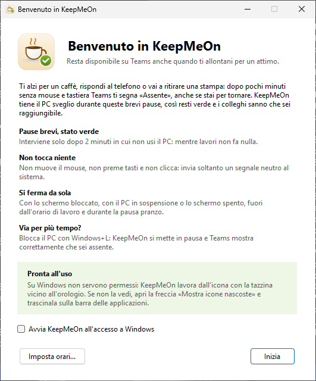
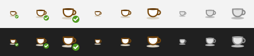
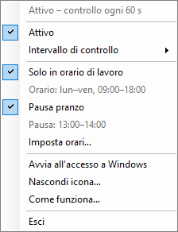
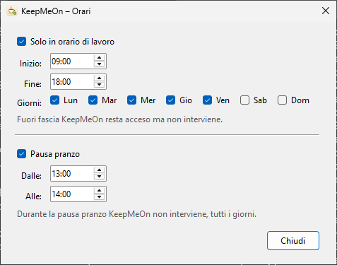

<p align="center">
  
</p>

<h1 align="center">KeepMeOn</h1>

<p align="center">
  Resta disponibile su Microsoft Teams anche quando ti allontani per un attimo.
</p>

<p align="center">
  <a href="https://github.com/christianmusumeci00/KeepMeOn/releases/latest/download/KeepMeOn.dmg"><b>Scarica per Mac</b></a>
  ·
  <a href="https://github.com/christianmusumeci00/KeepMeOn/releases/latest/download/KeepMeOn-Setup.exe"><b>Scarica per Windows</b></a>
  ·
  <a href="#installazione">Installazione</a>
  ·
  <a href="#compilare-da-zero">Compilare da zero</a>
</p>

<p align="center">
  
  
  
</p>

---

Ti alzi per un caffè, rispondi al citofono o vai a ritirare una stampa. Dopo circa 5 minuti senza mouse e tastiera, Teams ti segna **«Assente»**, anche se stai per tornare. KeepMeOn tiene il computer "presente" durante queste brevi pause, così resti **verde** e i colleghi sanno che sei raggiungibile.

È una piccola app nativa, senza dipendenze esterne:

- **Mac:** vive nella barra dei menu. È scritta in Swift e SwiftUI, occupa meno di 1 MB e a riposo usa circa 17 MB di memoria.
- **Windows:** vive nell'area di notifica, vicino all'orologio. È scritta in C# con Windows Forms su .NET Framework 4.8, già presente in Windows 10 e 11, quindi non c'è nulla in più da installare. L'installer pesa circa 2 MB.

<table>
  <tr>
    <th>Mac</th>
    <th>Windows</th>
  </tr>
  <tr>
    <td></td>
    <td></td>
  </tr>
</table>

## Cosa fa

- **Interviene solo quando non usi il computer.** Ogni 60 secondi controlla da quanto tempo non tocchi mouse, tastiera o trackpad, e agisce solo oltre i 2 minuti. Mentre lavori non fa nulla.
- **Non tocca niente.** Non muove il mouse, non preme tasti, non clicca e non apre niente: invia soltanto un segnale neutro al sistema (vedi [Come funziona](#come-funziona)).
- **Si ferma da sola** in quattro casi:
  - con lo schermo bloccato;
  - con il computer in stop o lo schermo spento;
  - fuori dall'orario di lavoro, se lo imposti;
  - durante la pausa pranzo, se la attivi.
- **Orario di lavoro:** ora di inizio e di fine e giorni della settimana (predefinito lun–ven, 09:00–18:00). Funzionano anche le fasce a cavallo della mezzanotte.
- **Pausa pranzo:** una fascia giornaliera in cui l'app non interviene (predefinita 13:00–14:00).
- **Avvio automatico** e possibilità di **nascondere l'icona**: KeepMeOn può lavorare senza nulla di visibile.
- **Non si collega a Internet e non raccoglie dati.** Le impostazioni restano sul tuo computer.

Se ti allontani a lungo, blocca il computer (**⌃⌘Q** su Mac, **Windows+L** su Windows): KeepMeOn si mette in pausa e Teams mostra correttamente che sei assente.

## Installazione

### Mac (macOS 13 Ventura o successivo)

1. Scarica **[KeepMeOn.dmg](https://github.com/christianmusumeci00/KeepMeOn/releases/latest/download/KeepMeOn.dmg)**.
2. Apri il DMG e trascina **KeepMeOn** nella cartella **Applicazioni**.
3. Apri **KeepMeOn** da Applicazioni o da Spotlight. L'app è firmata con un certificato Developer ID e notarizzata da Apple, quindi si apre con un doppio clic. Visto che arriva da Internet, macOS chiede una sola conferma: premi **Apri**.
4. **Permesso di Accessibilità.**
   1. Nella schermata di benvenuto premi **Apri Impostazioni Accessibilità** e attiva **KeepMeOn** nell'elenco.
   2. L'app si riavvia da sola: macOS applica questo permesso solo all'avvio.
   3. Il benvenuto ricompare con «Permesso attivo».
5. Premi **Inizia**. Se vuoi, attiva **Avvia KeepMeOn al login** direttamente dal benvenuto.

Nella barra dei menu compare una tazzina.

### Windows (Windows 10 e 11)

1. Scarica **[KeepMeOn-Setup.exe](https://github.com/christianmusumeci00/KeepMeOn/releases/latest/download/KeepMeOn-Setup.exe)** e avvialo.
2. L'installer non è firmato con un certificato a pagamento, quindi la prima volta Windows mostra «Windows ha protetto il PC». Clicca **Ulteriori informazioni** › **Esegui comunque**.
3. L'installazione è solo per il tuo utente: non servono permessi di amministratore. Se vuoi, lascia attiva l'opzione «Avvia KeepMeOn all'accesso a Windows».
4. Si apre la schermata di benvenuto: premi **Inizia**. Su Windows non c'è nessun permesso da concedere.

La tazzina compare nell'area di notifica, vicino all'orologio. Se non la vedi, apri la freccia «Mostra icone nascoste» e trascinala sulla barra delle applicazioni.

## Uso

### L'icona

<table>
  <tr>
    <th>Mac, barra dei menu</th>
    <th>Windows, area di notifica</th>
  </tr>
  <tr>
    <td></td>
    <td></td>
  </tr>
</table>

| Icona | Significato |
|---|---|
| Tazzina vuota (Mac) o grigia (Windows) | KeepMeOn è spenta |
| Tazzina senza spunta | Accesa ma in pausa: pranzo, fuori orario, schermo bloccato (su Mac anche permesso mancante) |
| Tazzina con spunta | Ti sta tenendo verde |

### Il menu

Su Mac si apre dalla tazzina nella barra dei menu; su Windows con un clic, sinistro o destro, sulla tazzina vicino all'orologio.

<p align="center">
  
</p>

| Voce | Cosa fa |
|---|---|
| Stato | Per esempio "Attivo – controllo ogni 60 s", "In pausa – pausa pranzo", "In pausa – schermo bloccato" |
| Ultimo intervento | Ora dell'ultima volta in cui KeepMeOn è intervenuta |
| Concedi il permesso di Accessibilità… | Solo su Mac, e solo se il permesso manca |
| Attivo | Accende o spegne l'app |
| Intervallo di controllo | 30, 60, 120 o 240 secondi (predefinito 60) |
| Solo in orario di lavoro | Limita l'azione alla fascia oraria |
| Pausa pranzo | Ferma l'app nella fascia della pausa, tutti i giorni |
| Imposta orari… | Apre la finestra con orario di lavoro e pausa pranzo |
| Avvia al login (Mac) / Avvia all'accesso a Windows | Avvia KeepMeOn all'accesso al computer |
| Nascondi icona… | Toglie l'icona. Per riaverla riapri KeepMeOn: su Mac da Spotlight o Applicazioni, su Windows dal menu Start |
| Come funziona… | Riapre la schermata di benvenuto |
| Esci | Chiude l'app |

### Orari

<table>
  <tr>
    <th>Mac</th>
    <th>Windows</th>
  </tr>
  <tr>
    <td></td>
    <td></td>
  </tr>
</table>

- Nell'orario di lavoro l'inizio è incluso e la fine esclusa: 09:00–18:00 vale fino alle 17:59.
- Se la fine viene prima dell'inizio (per esempio 22:00–06:00), la fascia scavalca la mezzanotte e conta per il giorno in cui è iniziata. Se inizio e fine coincidono, copre l'intera giornata.
- La pausa pranzo vale tutti i giorni; se inizio e fine coincidono è vuota.

## Come funziona

Teams va in «Assente» dopo circa 5 minuti in cui il contatore di inattività del sistema non si azzera. A ogni controllo, se non usi il computer da almeno 120 secondi, KeepMeOn fa due cose: chiede al sistema di restare sveglio e azzera quel contatore con un segnale neutro.

Servono entrambe le cose, su Mac come su Windows. La sola funzione "tieni sveglio" del sistema non azzera il contatore che legge Teams: è stato verificato su entrambi i sistemi.

### Mac

1. **Dichiara attività a macOS** con `IOPMAssertionDeclareUserActivity`: il sistema rimanda stop dello schermo, salvaschermo e stop del Mac.
2. **Azzera il contatore che legge Teams** (`CGEventSourceSecondsSinceLastEventType(combinedSessionState, …)`) con un evento `flagsChanged` "modificatori invariati". Per le app è come se lasciassi andare un tasto ⌘ ⌥ ⇧ ⌃ che non stavi premendo: nessun cursore, nessun carattere, nessun clic.
   - L'evento porta gli stessi modificatori già attivi (al massimo Blocco maiuscole) e non parte se un modificatore risulta premuto.
   - È marcato con l'identificativo `KMON`, quindi si riconosce.
   - Inviare eventi su macOS richiede il permesso di Accessibilità.

### Windows

1. **Chiede a Windows di restare sveglio** con `SetThreadExecutionState`: rimanda sospensione e spegnimento dello schermo.
2. **Azzera il contatore di inattività** (`GetLastInputInfo`) con `SendInput`, comunicando il rilascio di un tasto che non esiste: il codice virtuale 0x97, che Windows non assegna a nulla. Nessuna app ci reagisce e il cursore non si muove. Anche questo segnale è marcato `KMON`.
   - Su Windows non serve nessun permesso.

Su un computer con Windows 11 il segnale ha portato il contatore da 144 s a 0,3 s senza muovere il cursore, mentre la sola `SetThreadExecutionState` non lo azzerava.

### Tempi e soglia

Con i valori predefiniti il contatore non supera i 3 minuti circa: in una misura di 7 minuti e mezzo senza input su Mac è arrivato al massimo a 181 s, sotto i 300 s di Teams. Con l'intervallo di 240 s la soglia scende da sola a 21 s, così non si arriva mai ai 5 minuti.

La soglia di 120 s si può cambiare, poi va riavviata l'app.

Su Mac:

```bash
defaults write com.keepmeon.app idleThresholdSeconds -int 90
```

Su Windows:

```bat
reg add HKCU\Software\KeepMeOn /v IdleThresholdSeconds /t REG_DWORD /d 90 /f
```

## Compilare da zero

```bash
git clone https://github.com/christianmusumeci00/KeepMeOn.git
cd KeepMeOn
```

### Mac

**Requisiti:**
- macOS 13 Ventura o successivo.
- Xcode 15 o successivo, oppure i Command Line Tools con Swift 5.9 o successivo. I test (`swift test`) e la build universale potrebbero richiedere Xcode completo.

| Comando | Risultato |
|---|---|
| `./build.sh` | `dist/KeepMeOn.app` per l'architettura del tuo Mac |
| `UNIVERSAL=1 ./build.sh` | `dist/KeepMeOn.app` universale (Apple Silicon e Intel) |
| `./make-dmg.sh` | `dist/KeepMeOn.dmg` universale, con il collegamento ad Applicazioni (notarizzato se ci sono certificato e credenziali, vedi sotto) |
| `swift test` | test della logica (orari, pausa pranzo, stato, soglia) |

Poi avvia l'app:

```bash
open dist/KeepMeOn.app
```

**Firma.** `build.sh` sceglie da solo il certificato nel portachiavi, in quest'ordine:
1. "Developer ID Application": per distribuire. Firma con runtime protetto e marca temporale, come richiede la notarizzazione.
2. "Apple Development": per l'uso sul proprio Mac.
3. Se non trova nessuno dei due, firma ad-hoc.

Con un certificato macOS riconosce l'app da chi l'ha firmata, quindi il permesso di Accessibilità resta valido anche dopo una nuova build. Con la firma ad-hoc il permesso va ridato dopo ogni build.

Per scegliere la firma a mano:

```bash
SIGN_IDENTITY=- ./build.sh                     # forza la firma ad-hoc
SIGN_IDENTITY="Nome del certificato" ./build.sh
```

**Notarizzazione.** Con un certificato Developer ID, `make-dmg.sh` fa notarizzare da Apple prima l'app e poi il DMG. Poi allega a entrambi il ticket di notarizzazione e controlla che macOS li accetti. Prima salva le credenziali, una volta sola: ti verrà chiesta una [password per le app](https://support.apple.com/it-it/102654) del tuo ID Apple.

```bash
xcrun notarytool store-credentials "KeepMeOn" --apple-id "il-tuo-id-apple" --team-id "IL_TUO_TEAM_ID"
```

Senza credenziali il DMG viene comunque creato e firmato, ma non notarizzato.

### Windows

**Requisiti:**
- Per l'app e i test basta il [.NET SDK 10](https://dotnet.microsoft.com/download), su Windows, Mac o Linux: l'app punta a .NET Framework 4.8 e si compila ovunque.
- Per l'installer servono Windows e [Inno Setup 6](https://jrsoftware.org/isinfo.php).

| Comando | Risultato |
|---|---|
| `dotnet test windows/tests/KeepMeOn.Core.Tests` | test della logica (orari, pausa pranzo, stato, soglia) |
| `dotnet build windows/src/KeepMeOn -c Release` | `windows/src/KeepMeOn/bin/Release/net48/KeepMeOn.exe` |
| `ISCC.exe windows\installer\KeepMeOn.iss` (su Windows, dopo la build) | `windows/dist/KeepMeOn-Setup.exe` |

**Su GitHub.** A ogni modifica della cartella `windows/`, il flusso [`.github/workflows/windows.yml`](.github/workflows/windows.yml) fa tutto su un computer Windows:
- esegue i test;
- compila l'app;
- verifica che il segnale neutro azzeri davvero il contatore di inattività;
- fotografa le finestre;
- crea l'installer.

Il risultato si scarica dalla pagina della compilazione, con il nome «KeepMeOn-Windows».

### Icone

Sono disegnate in codice. Lo script crea l'icona per Mac e le icone `.ico` per Windows; va lanciato su un Mac:

```bash
swift Support/icon/make-icon.swift
```

## Domande frequenti

**Teams è diventato giallo lo stesso.**
Apri il menu e guarda lo stato:
- **"manca il permesso"** (solo Mac): il permesso di Accessibilità non è attivo per questa copia dell'app (vedi sotto);
- **"In pausa":** in quel momento è giusto che KeepMeOn non intervenga;
- **"Disattivato":** riattiva **Attivo**.

**Mac: il menu dice "manca il permesso" anche se nell'elenco Accessibilità l'interruttore è attivo.**
La voce nell'elenco appartiene a un'altra build di KeepMeOn, per esempio una compilata con un'altra firma, e riattivare l'interruttore non basta. Per sistemarla:
1. Cancella la voce:

   ```bash
   tccutil reset All com.keepmeon.app
   ```

2. Esci da KeepMeOn e riaprila.
3. Concedi di nuovo il permesso dal benvenuto o dal menu.

**Windows: all'avvio dell'installer compare «Windows ha protetto il PC».**
Succede perché l'installer non è firmato con un certificato a pagamento. Clicca **Ulteriori informazioni** › **Esegui comunque**. Serve solo la prima volta.

**Non vedo l'icona.**
- **Mac:** può essere nascosta da un gestore della barra dei menu (Bartender, Ice, Thaw…) o dalla tacca dello schermo.
- **Windows:** apri la freccia «Mostra icone nascoste» vicino all'orologio e trascina la tazzina sulla barra.
- Se l'hai nascosta tu con **Nascondi icona…**, riapri KeepMeOn (Spotlight su Mac, menu Start su Windows).

**Come verifico che funzioni?**
- Nel menu, "Ultimo intervento" mostra l'ora dell'ultima azione.
- Su Mac, per vedere ogni intervento in tempo reale:

  ```bash
  log stream --predicate 'subsystem == "com.keepmeon.app"' --level debug
  ```

- Su Windows ogni intervento è scritto in `%LOCALAPPDATA%\KeepMeOn\keepmeon.log`.

**Il computer non si blocca più da solo.**
È voluto: mentre KeepMeOn è attiva e non sei in pausa, il computer non va in stop per inattività. Quando ti allontani a lungo, bloccalo (⌃⌘Q su Mac, Windows+L su Windows).

## Limiti noti

- Con lo schermo bloccato o il computer in stop Teams va comunque in «Assente». È voluto.
- Lo stato impostato a mano in Teams, le riunioni e il calendario restano gestiti da Teams.
- Se Microsoft cambia il modo in cui Teams misura l'inattività, il comportamento potrebbe cambiare.
- Su Windows, se in primo piano c'è un programma avviato come amministratore, Windows può bloccare il segnale neutro (protezione UIPI) e Teams potrebbe andare in «Assente».
- Se il computer è gestito dall'azienda, verifica che l'uso sia consentito; le regole dell'IT possono anche impedire di installare programmi. Per un controllo IT l'app resta visibile: processo attivo, avvio automatico e, su Mac, elenco Accessibilità.

## Disinstallazione

### Mac

1. Dal menu disattiva **Avvia al login**, poi scegli **Esci**. Se l'icona è nascosta, riapri prima KeepMeOn per farla ricomparire.
2. Sposta `KeepMeOn.app` nel Cestino.
3. In Impostazioni di Sistema › Privacy e sicurezza › Accessibilità rimuovi KeepMeOn.
4. Facoltativo, per cancellare le impostazioni:

   ```bash
   defaults delete com.keepmeon.app
   ```

### Windows

1. Vai in Impostazioni › App › App installate.
2. Cerca **KeepMeOn** › **Disinstalla**.

La disinstallazione chiude l'app e toglie anche l'avvio automatico e le impostazioni.

## Struttura del progetto

```
KeepMeOn/
├── build.sh, make-dmg.sh       Mac: compilazione, firma, DMG e notarizzazione
├── Package.swift
├── Support/
│   ├── Info.plist              bundle id, LSUIElement, versione, icona
│   ├── AppIcon.icns
│   └── icon/make-icon.swift    disegna le icone per Mac e Windows
├── Sources/
│   ├── KeepMeOnCore/           Mac: logica pura (orari, pausa pranzo, stato), coperta dai test
│   └── KeepMeOn/               Mac: app per la barra dei menu (SwiftUI)
├── Tests/KeepMeOnCoreTests/
├── windows/
│   ├── src/KeepMeOn.Core/      Windows: la stessa logica pura in C#
│   ├── src/KeepMeOn/           Windows: app per l'area di notifica (Windows Forms)
│   ├── tests/                  test della logica (xUnit)
│   ├── tools/KeepMeOn.Probe/   verifiche su Windows: segnale neutro e immagini
│   └── installer/KeepMeOn.iss  installer (Inno Setup)
├── .github/workflows/windows.yml   compilazione e verifiche su Windows
└── docs/                       immagini del README
```

## Licenza

[MIT](LICENSE) © 2026 Christian Musumeci

Microsoft Teams è un marchio di Microsoft Corporation. KeepMeOn è un progetto indipendente, non affiliato né approvato da Microsoft.
